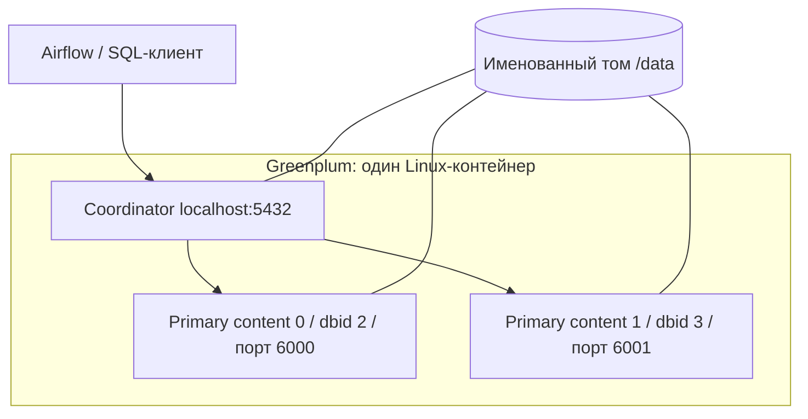
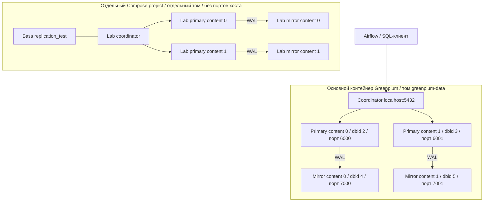

# Лабораторная №4: репликация Greenplum на macOS

Дата проверки: 27.10.2026, Europe/Moscow. Время в логах Greenplum — UTC. В файлах доказательств удалены только пробелы в конце строк и пустые строки в конце файла, добавлен завершающий перевод строки; диагностические значения сохранены.

## 1. Цель работы

Добавить настоящие mirror-сегменты к существующему Greenplum 7, проверить физическую синхронизацию, отказ отдельного primary, автоматическое повышение mirror, доступность данных, восстановление и сохранение конфигурации после перезапуска. Отказ проводится в отдельном Docker-стенде, а не в рабочей `dwh`.

## 2. Используемые технологии

| Компонент | Фактически проверенное значение |
|---|---|
| macOS | 26.3.1 (a), build 25D771280a |
| CPU | Apple Silicon, `uname -m`: `arm64` |
| RAM хоста | 17 179 869 184 байт, 16 ГиБ |
| Свободный диск перед развёртыванием | 183 ГиБ |
| Homebrew | `/opt/homebrew/bin/brew`, доступен |
| Docker Desktop / Engine | 4.36.0 / 27.3.1, Linux engine |
| Docker Compose | v2.30.3-desktop.1 |
| Память Docker | MemoryMiB=8092, Engine MemTotal=8 217 968 640 байт |
| PostgreSQL | 16.15, отдельные source и metadata |
| Airflow | 2.11.2, Python 3.11, LocalExecutor |
| MinIO | pgsty/minio RELEASE.2026-08-04T00-00-00Z |
| PowerShell | 7.6.6, официальный `osx-arm64` архив, `.cache/powershell/pwsh` |
| Greenplum | 7.0.0 build dev, PostgreSQL 12.12, aarch64, сборка 15.01.2026 |
| Образ | `andruche/greenplum:7`, фактическая архитектура `arm64` |

Engine первоначально был остановлен; установленный Docker Desktop запущен командой `open -a Docker`. Порты 5433, 5434, 8080, 9000 и 9001 перед развёртыванием не имели слушателей. Существующие посторонние контейнеры не запускались и не останавливались.

Команды диагностики:

```bash
uname -m
sw_vers
sysctl -n hw.memsize
df -h .
docker version
docker compose version
docker info
docker buildx imagetools inspect andruche/greenplum:7
lsof -nP -iTCP:5433 -iTCP:5434 -iTCP:8080 -iTCP:9000 -iTCP:9001 -sTCP:LISTEN
```

Manifest digest: `sha256:616f234725d424ed7ad951a6f4f4cff11055d73aa767758ff7a9049ed2a968a9`. ARM64 manifest: `sha256:bfc304487cc6c44375f4d5b66f2801df4bdf6006794cd424669ffc5eb8990f22`. Также доступен amd64; принудительная эмуляция не применялась.

Стабильный Homebrew cask `powershell` отсутствовал. Использован [официальный способ установки Microsoft из архива](https://learn.microsoft.com/powershell/scripting/install/installing-powershell-on-macos), без sudo и изменения Gatekeeper/TLS. Для локальной установки в терминале:

```bash
export PATH="$PWD/.cache/powershell:$PATH"
pwsh --version
```

Git до начала работы: чистая `main`, remote `origin` — репозиторий проекта. Создана ветка `lab4-replication`. На этапе реализации commit и push не выполнялись; публикация ветки выполняется отдельно после финального ревью. Секреты, `.env`, скачанные архивы и переносимая установка PowerShell остаются в игнорируемых каталогах.

## 3. Исходная архитектура Greenplum

Изучены README, Compose, env example, Dockerfile/requirements Airflow, четыре PowerShell-скрипта, Greenplum init SQL, EDW SQL, DAG, модули EDW, тесты и отчёт этапа 3. В исходном Compose том Greenplum уже смонтирован в `/data`; образ содержит заранее инициализированный кластер.

[Исходный код образа](https://github.com/andruche/docker-greenplum/blob/master/7/DockerFile) и [entrypoint](https://github.com/andruche/docker-greenplum/blob/master/entrypoint.sh) сопоставлены с реальным контейнером. На старте запускаются SSH и `gpstart`; при корректном завершении — `gpstop`. Данные координатора и всех сегментов находятся в `/data`, а не во временном слое контейнера. Для утилит необходим пользователь `gpadmin` и `source /usr/local/gpdb/greenplum_path.sh`.



До настройки:

```text
dbid content role preferred_role mode status port hostname  datadir
1    -1      p    p              n    u      5432 localhost /data/coordinator/gpsne-1
2     0      p    p              n    u      6000 localhost /data/data1/gpsne0
3     1      p    p              n    u      6001 localhost /data/data2/gpsne1
```

Два активных primary, зеркал нет. `mode=n` означает отсутствие синхронизированного зеркала. Исходный вывод `gpstate -s` и каталога: [lab-before.txt](stage4-evidence/lab-before.txt).

## 4. Механизм репликации

Используется штатное физическое зеркалирование сегментов Greenplum: primary передаёт WAL соответствующему mirror. Это не копирование SQL-таблиц сторонним приложением. Копируется физическое состояние сегмента, включая данные разных баз и схем.

FTS координатора обнаруживает недоступность primary и повышает его зеркало. Пара определяется одинаковым `content`; `dbid` идентифицирует конкретный экземпляр. `role` показывает текущую роль, `preferred_role` — исходное назначение. В штатном состоянии у каждой пары один `p`, один `m`, оба `status=u`, `mode=s`. При отказе роли меняются, а пара временно работает без синхронного резервного экземпляра.

Вывод `gpstate -s` после настройки показал `Mirror status = Synchronized` для primary и `Streaming` для mirror; остаток отправки/flush/replay WAL — 0 байт. Проверка каталога дополняет, а не заменяет диагностику реальной репликации.

## 5. Настройка mirror-сегментов

Новые файлы:

- `compose.replication.yaml`: отдельный стенд, том `greenplum-replication-lab_replication-data`, отдельная сеть, без портов хоста;
- `scripts/replication/run.sh`: macOS Bash 3.2, вызовы Docker CLI;
- `scripts/replication/container.sh`: команды Greenplum внутри Linux от `gpadmin`;
- `tests/test_replication.py`: обычные живые проверки;
- `tests/test_replication_fault.sh`: отдельный явный отказный тест.

Основной Greenplum не пересоздавался. Для платформы:

```bash
bash scripts/replication/run.sh platform status
bash scripts/replication/run.sh platform setup
bash scripts/replication/run.sh platform check
```

Для изолированного стенда:

```bash
bash scripts/replication/run.sh lab up
bash scripts/replication/run.sh lab setup
bash scripts/replication/run.sh lab prepare
```

Скрипт проверяет два здоровых primary, ожидаемую топологию localhost и `/data`, SSH без пароля (`ssh -o BatchMode=yes localhost true`). Список корневых каталогов зеркал передаётся `gpaddmirrors`. Конфигурацию и порты рассчитывает сама установленная утилита:

```bash
gpaddmirrors -a -o /data/replication-lab/mirrors.conf \
  -m /data/replication-lab/mirror-directories
gpaddmirrors -a -i /data/replication-lab/mirrors.conf
```

Offset по умолчанию 1000: 6000 → 7000, 6001 → 7001. Утилита проверяет размещение и порты. Каталоги `/data/mirror1` и `/data/mirror2` находятся на уже сохраняемом томе. На платформе фактические datadir — `gpsne0`/`gpsne1`, в выполненном лабораторном эксперименте — `gp0`/`gp1`; имена сгенерированы утилитой, не используются как произвольно назначенные пути.

`setup` при существовании двух зеркал только ожидает синхронизации; частичную конфигурацию автоматически не достраивает. Два последовательных запуска не изменили dbid, content, роли, hostname, порты и datadir. Конкурирующие операции ограничены `flock` внутри Linux-контейнера. Именованный Compose project задаётся через `-p`, поскольку переменная `COMPOSE_PROJECT_NAME` из `.env` имеет приоритет над `name` в YAML.

## 6. Архитектура после изменений



Один coordinator, два primary и два mirror в каждом кластере. Рабочая `dwh` не используется для fault injection. Её таблицы и политики распределения не изменены новой реализацией.

## 7. Проверка синхронизации

Контрольный SQL:

```sql
SELECT content,dbid,role,preferred_role,mode,status,hostname,port,datadir
FROM gp_segment_configuration
WHERE content >= 0 ORDER BY content,dbid;
```

Результат основной платформы после настройки:

```text
0|2|p|p|s|u|localhost|6000|/data/data1/gpsne0
0|4|m|m|s|u|localhost|7000|/data/mirror1/gpsne0
1|3|p|p|s|u|localhost|6001|/data/data2/gpsne1
1|5|m|m|s|u|localhost|7001|/data/mirror2/gpsne1
```

Независимо выполнены `gpstate -m` и `gpstate -e`: два Passive/Synchronized mirror и `All segments are running normally` ([вывод](stage4-evidence/platform-gpstate.txt)). Подтверждены два разных content, по одному primary и mirror на content, оба в синхронном режиме и доступны: [platform-mirrors.txt](stage4-evidence/platform-mirrors.txt).

Дополнительно на каждом primary выполнен безопасный utility-запрос:

```bash
# Внутри контейнера после загрузки greenplum_path.sh:
PGOPTIONS='-c gp_role=utility' psql -h localhost -p 6000 -U gpadmin -d postgres \
  -c 'SELECT application_name,state,sync_state,sent_lsn,flush_lsn,replay_lsn FROM pg_stat_replication'
# То же для порта 6001.
```

В обоих случаях фактически получены `gp_walreceiver | streaming | sync`; sent/flush/replay LSN совпали (`0/C018B90` на момент запроса). Это отдельное подтверждение синхронной физической передачи WAL: [wal-streaming.txt](stage4-evidence/wal-streaming.txt).

## 8. Эксперимент с отказом primary

Перед экспериментом проверены синхронизация всех четырёх экземпляров, контрольный набор, метка изолированного контейнера и возможность восстановления. Не остановлен ни coordinator, ни весь контейнер. Выбран конкретный primary content=0, dbid=2, порт 6000, `/data/data1/gpsne0`.

Явная команда:

```bash
bash tests/test_replication_fault.sh --inject-fault
```

Внутри выполняется:

```bash
pg_ctl -D /data/data1/gpsne0 stop -m immediate -w -t 30
```

Для ускорения очередного сканирования вызывается штатная `gp_request_fts_probe_scan()`. Решение о promotion принимает Greenplum; SQL UPDATE системного каталога и ручное назначение ролей не применяются.

До отказа пара 0: `dbid=2 p/p/s/u`, `dbid=4 m/m/s/u`. После отказа получено:

```text
0|2|m|p|n|d|localhost|6000|/data/data1/gpsne0
0|4|p|m|n|u|localhost|7000|/data/mirror1/gp0
1|3|p|p|s|u|localhost|6001|/data/data2/gpsne1
1|5|m|m|s|u|localhost|7001|/data/mirror2/gp1
```

Таким образом, исходный primary действительно down, бывший mirror имеет текущую роль primary и прежнюю предпочтительную роль mirror. Это наблюдаемое переключение, а не повтор подключения к прежнему процессу. Пара content=1 не менялась. Полный вывод эксперимента и восстановления: [failover.txt](stage4-evidence/failover.txt).

## 9. Проверка доступности данных

В `replication_test` создана отдельная таблица:

```sql
CREATE TABLE public.replication_probe (
    id integer PRIMARY KEY,
    payload text NOT NULL
) DISTRIBUTED BY (id);
INSERT INTO public.replication_probe
SELECT id,md5(id::text) FROM generate_series(1,10000) id;
```

Проверяются все 10 000 различных ключей в диапазоне, соответствие каждого payload, отсутствие посторонних ключей/значений, количество и отпечаток упорядоченного набора:

```sql
SELECT count(*),sum(id),
       md5(string_agg(id::text || ':' || payload,',' ORDER BY id))
FROM public.replication_probe;
SELECT gp_segment_id,count(*)
FROM public.replication_probe GROUP BY gp_segment_id ORDER BY gp_segment_id;
```

| Момент | Строк | Сумма id | MD5 набора |
|---|---:|---:|---|
| До отказа | 10 000 | 50 005 000 | `931fe74f52e4399c243353f6866ea6a2` |
| После promotion, до INSERT | 10 000 | 50 005 000 | `931fe74f52e4399c243353f6866ea6a2` |
| После INSERT | 10 001 | 50 015 001 | `56bf4e0b85f489cfa41b201a792f7aa4` |
| После recovery и rebalance | 10 001 | 50 015 001 | `56bf4e0b85f489cfa41b201a792f7aa4` |
| После restart контейнера | 10 001 | 50 015 001 | `56bf4e0b85f489cfa41b201a792f7aa4` |

До отказа content=0 содержал 5013 строк, content=1 — 4987. После безопасного INSERT получено 5014 и 4987 соответственно: новая строка относится именно к переключившемуся content=0.

```sql
INSERT INTO public.replication_probe
SELECT 10001,md5('10001')
WHERE NOT EXISTS (SELECT 1 FROM public.replication_probe WHERE id=10001);
```

Первый запуск дал `INSERT 0 1`; повторный использует ту же контрольную запись без дубликата. Прикладные SQL-запросы выполнены через coordinator. Рабочие данные не записывались отказным тестом.

## 10. Восстановление сегмента

Синтаксис предварительно проверен через `gprecoverseg --help` непосредственно установленной версии:

```bash
gprecoverseg -a
# После восстановления и полной синхронизации:
gprecoverseg -a -r
```

Штатное incremental recovery выполнило `pg_rewind` для dbid=2 (`pg_rewind: Done!`, `Segments successfully recovered`). После первой синхронизации восстановленный dbid=2 временно служил mirror. Rebalance вернул исходные роли; утилита сообщила `The rebalance operation has completed successfully`.

Скрипт ожидает здоровые синхронные пары между стадиями. При обычном выходе, ошибке SQL или сигнале INT/TERM обработчик EXIT пытается выполнить recovery. При аварийном завершении Docker/хоста автоматическое завершение обработчика не гарантируется; предусмотрена отдельная команда:

```bash
bash scripts/replication/run.sh lab recover
```

Не используются удаление datadir, уничтожение томов или пересоздание БД для восстановления.

## 11. Проверка повторной синхронизации

Итоговое состояние лабораторного кластера:

```text
0|2|p|p|s|u|localhost|6000|/data/data1/gpsne0
0|4|m|m|s|u|localhost|7000|/data/mirror1/gp0
1|3|p|p|s|u|localhost|6001|/data/data2/gpsne1
1|5|m|m|s|u|localhost|7001|/data/mirror2/gp1
```

Затем выполнен реальный `docker compose restart greenplum` изолированного проекта без удаления томов. После Docker healthcheck снова проверены обе синхронные пары и равенство отпечатков до/после restart. Результат: PASS, все 10 001 строка сохранены. Доказательство: [restart.txt](stage4-evidence/restart.txt).

Каталог координатора с системной конфигурацией, primary, mirror и файлы настроек/снимков `/data/replication-lab` находятся в именованном томе `/data`. Это сохраняет конфигурацию при перезапуске контейнера. Пересоздание контейнера с тем же образом и томом не требует повторной инициализации; отдельный эксперимент пересоздания не проводился.

## 12. Результаты автоматизированных тестов

```bash
python3 tests/test_replication.py
bash tests/test_replication_fault.sh --inject-fault
bash scripts/replication/run.sh lab restart
```

Семь обычных интеграционных тестов (включая запрет fault injection без изоляции и явного флага): два primary; два mirror; корректные пары с `u/s`; возврат предпочтительных ролей; целостность тестовой таблицы; два повторных setup без изменения конфигурации. Все прошли, [tests.txt](stage4-evidence/tests.txt).

Отдельный отказный сценарий проверил реальную остановку, повышение прежнего mirror по dbid/role/preferred_role/status, SELECT, сохранение исходного набора и INSERT, recovery, rebalance и повтор обычных тестов. Дополнительно проверяется, что запись 10001 сохранилась после recovery. Повторный отказный эксперимент также прошёл: [failover-repeat.txt](stage4-evidence/failover-repeat.txt). Он не вызывается обычным start или тестами EDW.

`bash -n` новых shell-скриптов, Python compilation, PowerShell parser существующих четырёх скриптов и `docker compose config --quiet` обоих Compose прошли. Минимальные изменения существующей инфраструктуры: установка demo через системный `curl`, проверка скачанного `.partial`, закрепление совместимого URL, отказ от повторного импорта существующей базы и проверка точных количеств восьми таблиц. ETL, DQ, модель SQL и распределение существующих таблиц не изменены.

Финальное ревью перед публикацией: повторены все команды демонстрации, семь обычных тестов, явный failover с восстановлением и перезапуск из родительского каталога репозитория. Исправлено повторное обращение к скрипту через относительный `$0`: теперь используется абсолютный путь. Локальные ссылки и внешние ссылки на документацию проверены; кэши, архивы, `.env` и рабочие логи Airflow исключены из публикации.

### Совместимость с исходной платформой

На этом Mac исходных контейнеров/данных проекта не было. Платформа развёрнута впервые; исторический отчёт этапа 3 не считается доказательством нового запуска.

PostgreSQL 16.15 получил совместимую demo-базу из `demo-big-20161013.zip` (HTTP 200; 243 177 988 байт). При первоначальном импорте старый дамп вывел две ожидаемые ошибки служебных команд: `DROP DATABASE demo` при отсутствии базы и повторное создание уже существующей `public`. Остальные операции импорта, индексы и ограничения завершились; проверены 26 ограничений, все `convalidated=true`. Эти сообщения не выдаются за отсутствие ошибок импорта. Существующий режим импортера `ON_ERROR_STOP=0` сохранён для старого дампа; итог проверяется отдельно.

| Таблица источника | Фактические строки |
|---|---:|
| aircrafts | 9 |
| airports | 104 |
| bookings | 2 111 110 |
| seats | 1 339 |
| flights | 214 867 |
| tickets | 2 949 857 |
| ticket_flights | 8 391 852 |
| boarding_passes | 7 925 812 |
| Всего | 21 594 950 |

Повторный `pwsh -File ./scripts/install-demo-db.ps1` подтвердил существование базы и выполнил только проверки, без повторного импорта: [demo-counts.txt](stage4-evidence/demo-counts.txt). Суммы `bookings.total_amount` и `ticket_flights.amount` — каждая `167409059100.00`: [source-checks.txt](stage4-evidence/source-checks.txt). В `dwh` подтверждены все четыре схемы: [dwh-schemas.txt](stage4-evidence/dwh-schemas.txt).

Штатный `pwsh -File ./scripts/start.ps1` завершился успешно, затем `pwsh -File ./scripts/run-edw.ps1` создал ручной запуск. После unpause Airflow также создал плановый запуск; первый плановый конвейер полностью завершился успешно. Выполнен диагностический DAG `platform_healthcheck`: все три задачи success. HTTP MinIO `/minio/health/live` вернул 200, Airflow `/health` показал healthy metadatabase и свежий healthy Scheduler heartbeat.

При первом включении ежедневный аудит начал работу до создания таблиц EDW: попытка 1 получила `relation dq.layer_state does not exist`, попытка 2 — отсутствие опубликованной DM. На третьей автоматической попытке после построения DM аудит завершился success, 44 PASS и ноль предупреждений. Изменения расписания, ручное обнуление истории ошибок и очистка task instances не применялись. Исходные сообщения сохранены: [startup-dq-retries.txt](stage4-evidence/startup-dq-retries.txt).

Неизменённый `tests/test_edw.py` запущен в отдельной `edw_stage3_test`: 6/6 PASS ([edw-tests.txt](stage4-evidence/edw-tests.txt)). Он проверяет отрицательные данные и карантин специально, поэтому WARN в его логе относятся к тестовому набору. В рабочем первом пакете карантин равен нулю. Ручной пакет **дождались до success**. Плановый `scheduled__2026-10-26T00:00:00+00:00` завершён 27.10.2026 в 11:33:06 UTC; ручной `manual__2026-10-27T11:29:35+00:00` — в 11:36:02 UTC. Все 12 созданных DAG runs, включая дочерние и диагностику, имеют итоговый success: [dag-runs.txt](stage4-evidence/dag-runs.txt).

Выполнен неизменённый `sql/edw/003_verify.sql`, в том числе повторно после контрольного перезапуска основного Greenplum: [edw-verify.txt](stage4-evidence/edw-verify.txt). Оба полных пакета и ежедневный аудит получили по 44 PASS, результатов WARN/FAIL нет, карантин пуст. Количество каждой из восьми таблиц в Staging и Core совпало с источником — по 21 594 950 строк. Суммы бронирований и оплаченных перелётов во всех трёх слоях совпали с PostgreSQL: каждая `167409059100.00`.

| Витрина | Фактические строки после второго пакета |
|---|---:|
| dm.ticket_flight_details | 8 391 852 |
| dm.flight_airport_daily | 178 437 |
| dm.booking_sales_daily | 392 |
| dm.exchange_rates_daily | 90 |

Первый пакет курсов обработал 30 дат 27.09–26.10.2026 и 90 строк. Второй перечитал семь дат и 21 строку; в Core и DM сохранилось 90 строк за 30 дат. Дубликатов дат/валют не найдено. MinIO содержит 37 исходных XML-объектов двух пакетов ([minio-objects.txt](stage4-evidence/minio-objects.txt)).

После завершения всех DAG подтверждено отсутствие running/queued runs и активных клиентских SQL-запросов. Затем основной Greenplum перезапущен без удаления тома:

```bash
bash scripts/replication/run.sh platform check
docker compose restart greenplum
docker compose up -d --wait greenplum
bash scripts/replication/run.sh platform check
```

До/после сравнили 16 счётчиков строк Staging/Core и суммы двух денежных показателей в Staging/Core/DM: `cmp` подтвердил точное равенство. Все четыре сегмента основной платформы вернулись в `u/s` с исходными ролями. Доказательство: [platform-restart.txt](stage4-evidence/platform-restart.txt), [data-after-restart.txt](stage4-evidence/data-after-restart.txt). Существующие шесть тестов EDW после этого снова прошли.

Итоговые сервисы: PostgreSQL source, PostgreSQL metadata, Greenplum, MinIO, Airflow Webserver и Scheduler работают; все предусмотренные healthchecks healthy. `greenplum-init` и `airflow-init` штатно завершены с кодом 0 ([services.txt](stage4-evidence/services.txt)). В MinIO Compose healthcheck не предусмотрен, поэтому проверены HTTP health endpoint и настоящий S3-запрос. Airflow heartbeat и MinIO endpoint: [airflow-health.json](stage4-evidence/airflow-health.json), [minio-health.txt](stage4-evidence/minio-health.txt). Отдельный лабораторный контейнер также оставлен работающим: [lab-final.txt](stage4-evidence/lab-final.txt).

## 13. Ограничения демонстрационного стенда

- Одноконтейнерные primary/mirror демонстрируют отказ процесса, а не отказ контейнера, VM, диска или физического Mac. Общий том не является независимой резервной копией.
- Coordinator один, standby coordinator отсутствует.
- Образ — community-сборка `7.0.0 build dev`; промышленное развёртывание не заявляется.
- Для production нужны отдельные failure domains, отдельные диски/хосты для mirror, standby, резервные копии и мониторинг.
- При незавершённых транзакциях клиенты могут получить ошибку и должны повторить всю транзакцию. Бесшовное продолжение любой текущей сессии не заявляется.
- `gprecoverseg -r` прерывает текущие запросы: демонстрация выполняется без пользовательской нагрузки.
- Оба Greenplum-кластера вместе с Airflow и исходной БД требуют дополнительной RAM и диска; после защиты изолированный стенд можно остановить без удаления тома.
- Скрипты рассчитаны на проверенную двухсегментную localhost-топологию образа. Изменение числа сегментов или переход к нескольким контейнерам требует отдельной настройки.

## 14. Вывод

Настоящее зеркалирование WAL Greenplum, две синхронные пары, реальный failover primary content=0, доступность SELECT/INSERT, incremental recovery и возврат ролей подтверждены на Mac с ARM64. Контрольная сумма сохранилась после переключения, восстановления и перезапуска. Конфигурация основной платформы расширена зеркалами без пересоздания Greenplum; отказная демонстрация изолирована от `dwh`. Все критерии лабораторной №4 выполнены. Исходная платформа прошла два сквозных запуска ETL, DQ, существующие тесты и контрольный перезапуск с сохранением данных.
